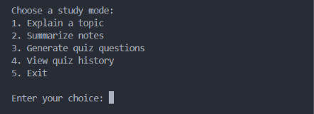

# AI Study Assistant

A command-line study assistant built with Python and the Groq API. It helps students understand topics, summarize notes, and practice with AI-generated quizzes.

## Application Preview




## Features

- **Explain Topics:** Get clear explanations in simple English with examples.
- **Summarize Notes:** Turn study notes into concise summaries.
- **Generate Quizzes:** Generate five multiple-choice questions on a chosen topic.
- **AI-Powered Feedback:** Receive an explanation after each quiz answer.
- **Automatic Scoring:** Calculate your quiz score and percentage.
- **Quiz History:** Save and review previous quiz results.

## Technologies

- Python 3.11
- Groq API
- Large Language Models (LLMs)
- JSON
- python-dotenv

## Project Structure

```text
ai-study-assistant/
├── src/
│   ├── main.py
│   ├── gemini_helper.py
│   └── quiz_history.py
├── .gitignore
├── requirements.txt
└── README.md
```

The `.env` file, virtual environment, and quiz history data are kept locally and are not intended to be uploaded to GitHub.

## Requirements

- Python 3.11 or a compatible version
- Internet connection
- A Groq API key

## Installation

### 1. Clone the repository

```bash
git clone https://github.com/Loyd9509/ai-study-assistant.git
cd ai-study-assistant
```

### 2. Create a virtual environment

On Windows PowerShell:

```powershell
python -m venv venv
.\venv\Scripts\Activate.ps1
```

### 3. Install dependencies

```bash
python -m pip install -r requirements.txt
```

### 4. Configure your API key

Create a file named `.env` in the project root.

Add this line to the file:

```text
GROQ_API_KEY=your_groq_api_key_here
```

Replace the example value with your own Groq API key.

**Security:** Never commit or publish your real API key. Keep `.env` private.

### 5. Run the application

```bash
python src/main.py
```

Follow the menu instructions to explain a topic, summarize notes, generate a quiz, view quiz history, or exit.

## What I Learned

- Writing and organizing Python functions
- Connecting Python applications to an AI API
- Processing JSON responses
- Handling errors and invalid input
- Reading and writing files
- Using Git and GitHub for version control

## Future Improvements

- Add quiz difficulty levels.
- Track learning progress over time.
- Improve quiz generation and validation.
- Add a graphical user interface.
- Support importing study notes from files.

---

Created as a learning project to explore Python and AI application development.
